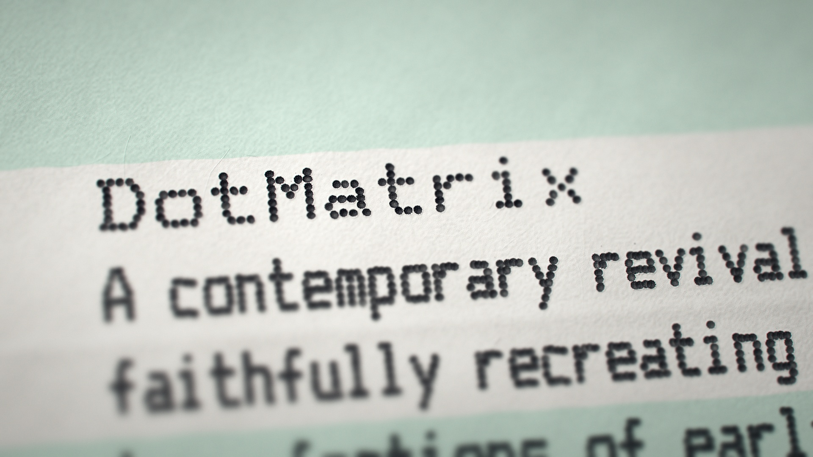
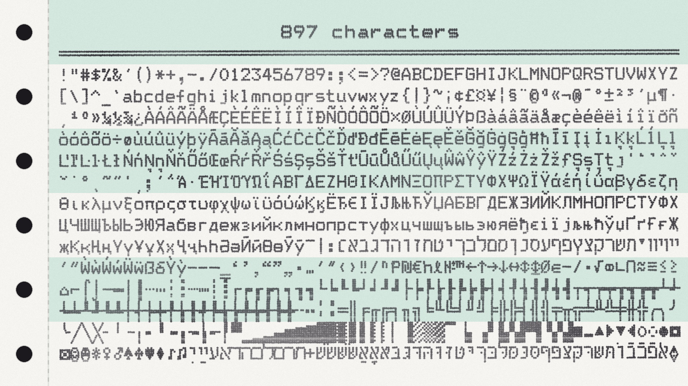

# DotMatrix

**[Browse all glyphs →](https://gissio.github.io/font_DotMatrix)**

**DotMatrix** is a contemporary revival of classic 1980s dot matrix printing, faithfully recreating the texture, rhythm, and mechanical imperfections of early impact printers. Inspired by the iconic Epson FX-80, it captures the distinctive look of inked pins striking paper—bringing authentic retro computing aesthetics into modern digital typography.

Designed for nostalgia-driven interfaces, ASCII/ANSI art, and coding environments, DotMatrix balances historical accuracy with practical usability. For optimal fidelity, use the font at **10 pt**, its original physical scale: a row of dots is then 1/72 inch, the spacing of the 9 pins of the print head.

## The fonts

DotMatrix comes in two groups: **DotMatrix Mono**, the monospace fonts, and **DotMatrix Sans**, the same letters in the printer's proportional mode. Each has 6 families, one for each pitch of the printer, in 4 styles: 48 fonts in all. You pick the mode by picking the family.

| Epson FX-80 mode    | Pitch (cpi) | Family                                 | Use it for                         |
| ------------------- | ----------- | -------------------------------------- | ---------------------------------- |
| Elite               | 12          | **DotMatrix Mono**                     | Code editors and terminals         |
| Pica                | 10          | DotMatrix Mono SemiExpanded            | The default look of the printer    |
| Compressed          | 17.16       | DotMatrix Mono Condensed               | Dense listings                     |
| Expanded Compressed | 8.58        | DotMatrix Mono Expanded                | Headlines and banners              |
| Expanded Elite      | 6           | DotMatrix Mono ExtraExpanded           | Headlines and banners              |
| Expanded Pica       | 5           | DotMatrix Mono UltraExpanded           | Headlines and banners              |
| Proportional        |             | **DotMatrix Sans**, in the same widths | Running text that reads as typeset |

The plain **DotMatrix Mono** is Elite: at 10 pt it is 0.6 em wide, the cell of the common coding fonts, so it fits the column settings of editors and terminals. The names use the width words of the OpenType width classes, as ranks rather than exact percentages.

The styles are Regular, Bold, Italic and Bold Italic. **Bold** is the printer's double strike: the second strike is half a row lower.

## Features

* **897 characters**: the Epson FX-80 character set, DOS code pages 437 and 850, Google Fonts Latin, Greek and Cyrillic Core, and Hebrew. As on the printer, the italic styles slant the text characters, while the graphic characters (box drawing, blocks, shapes, arrows, math symbols) and the Hebrew letters stay upright.
* **Dot jitter**: subtle, controlled irregularities simulate the mechanical variance of the print head, reproducing the wobble of real dot matrix output.
* **The ink of a coding font**: the dots are 1.10 of a row, bigger than the pins of the printer, as the ink of the ribbon spreads, so that Regular and Bold have the ink of the common coding fonts, such as JetBrains Mono. Neighbouring dots overlap a little, so the strokes are continuous and the dotted look stays.

## Using the fonts

The built fonts are in `fonts/`: `ttf` and `otf` for desktop applications, and `webfonts` (`.woff2`) for the web, where each style is a font of its own:

```css
@font-face {
  font-family: "DotMatrix Mono";
  src: url("fonts/webfonts/DotMatrixMono-Regular.woff2") format("woff2");
}

code {
  font-family: "DotMatrix Mono", monospace;
  font-size: 10pt;
  line-height: normal;
}
```

The line height of the fonts is 12 rows, 1.2 em: the 6 lines per inch of the printer. Editors and browsers that use the line height of the font get it without any setting.

## Samples




## Releases

### 2.000

* The fonts are in two groups: **DotMatrix Mono**, the monospace fonts, which were DotMatrix, and **DotMatrix Sans**, the proportional fonts, which were DotMatrix Var.
* Corrected the pitches to those of the Epson FX-80, and gave Pica the real 1.2:1 aspect of its dots. **DotMatrix Mono** is now Elite (12 cpi, 0.6 em wide at 10 pt, the cell of the common coding fonts), which was DotMatrix SemiCondensed. Pica (10 cpi) is now **DotMatrix Mono SemiExpanded**, which was DotMatrix Expanded. Compressed (17.16 cpi) is now **DotMatrix Mono Condensed**.
* The fonts are named by their width, not by the number of strikes. **Duo** is now Expanded, ExtraExpanded or UltraExpanded, with unchanged pitches and shapes.
* Dropped **Duo UltraCondensed** and **Quad**, the Emphasized modes, which strike every dot twice side by side: Bold makes the text heavier.
* The dots are 1.10 of a row, bigger than the pins of the printer, so that the ink of Regular and Bold matches the common coding fonts.
* Regular is weight 400 and Bold is weight 700.
* Combining marks have zero advance and attach to their base letters.
* New specimen and presentation images, built by `documentation/build-specimen.py` (`make images`).
* Updated bdf2ufo to 1.8.
* The build converts the `.kbitx` sources with `scripts/kbitx2bdf.py` and runs with `make build`. Added `build-wsl.sh`.
* Added a [glyph viewer](https://gissio.github.io/font_DotMatrix) of DotMatrix Mono Regular (`index.html`), updated by `scripts/update-index.py` on `make build`.
* The Google Fonts description is now the article `documentation/ARTICLE.en_us.html`, updated to this release, with the specimen images.

### 1.001

* Updated bdf2ufo to 1.1.

### 1.000

* Initial release.

## Build

To build the fonts from source, you need Python 3.10+, `pip`, `virtualenv` and `make`. Then run:

```bash
make build
```

The fonts are placed in `fonts/`, and the glyph table of the glyph viewer (`index.html`) is updated from DotMatrix Mono Regular. Other targets:

* `make images`: builds the specimen and presentation images in `documentation/`.
* `make test`: tests the fonts with fontspector.
* `make clean`: removes the venv and the generated files.

On Windows, run `./build-wsl.sh` from WSL, with the make targets you want (`build` by default, for example `./build-wsl.sh images`): it runs make in a copy on the Linux filesystem, which is much faster than building under `/mnt`, and copies the fonts, `index.html` and the images back.

## Designer

**Stefan Schmidt** is an electrical engineer with graduate studies in signal processing, as well as a background in artistic practices and sociology. His work explores the intersection of perception, technology, and material systems—bridging the virtual and the physical through experimental design.

Learn more: [http://www.stefanschmidtart.com](http://www.stefanschmidtart.com)

## License

This project is licensed under the **SIL Open Font License, Version 1.1**.
Full text and FAQ: [https://scripts.sil.org/OFL](https://scripts.sil.org/OFL)
