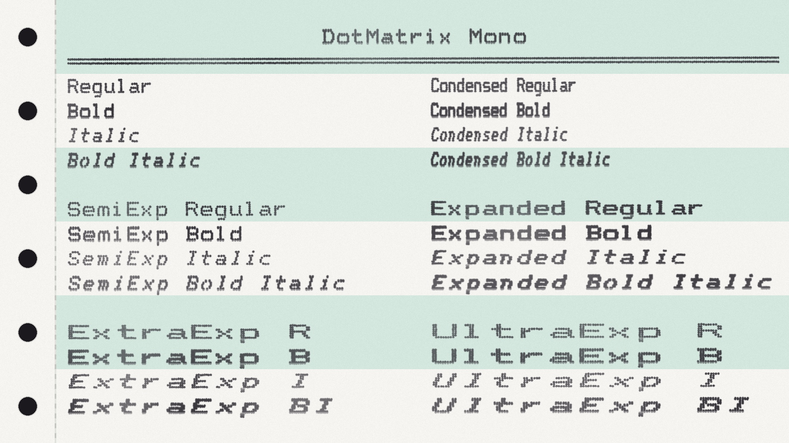
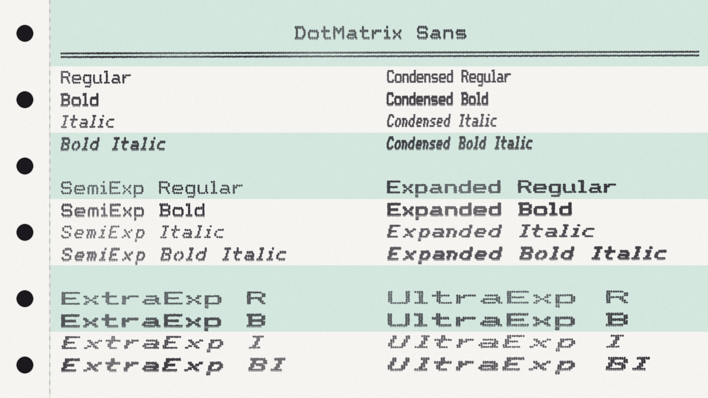
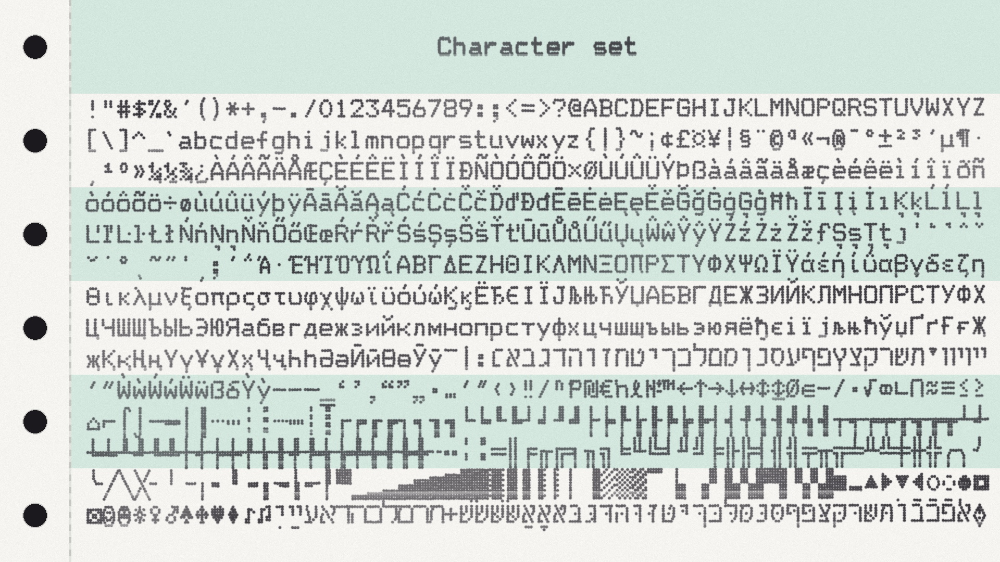

# DotMatrix

**DotMatrix** is a contemporary revival of classic 1980s dot matrix printing, faithfully recreating the texture, rhythm, and mechanical imperfections of early impact printers. Inspired by the iconic Epson FX-80, it captures the distinctive look of inked pins striking paper—bringing authentic retro computing aesthetics into modern digital typography.

Designed for nostalgia-driven interfaces, ASCII/ANSI art, and coding environments, DotMatrix balances historical accuracy with practical usability. For optimal fidelity, use the font at **10 pt**, its original physical scale: a row of dots is then 1/72 inch, the spacing of the 9 pins of the print head.

## Which font?

DotMatrix is 16 families of 4 styles each, 64 fonts in all: one family for every print mode of the printer. You pick the mode by picking the family.

| You want                                 | Use                                              |
| ---------------------------------------- | ------------------------------------------------ |
| Code editors and terminals               | **DotMatrix**                                    |
| The default look of the printer          | DotMatrix SemiExpanded                           |
| Dense listings                           | DotMatrix Condensed                              |
| Headlines and banners                    | DotMatrix Expanded, ExtraExpanded, UltraExpanded |
| Heavier text, by the printer's own means | DotMatrix Emphasized SemiExpanded                |
| Running text that reads as typeset       | DotMatrix Prop (the proportional families)       |

The plain **DotMatrix** is Elite, the 12 characters per inch mode. At 10 pt it is 0.6 em wide, the cell that the common coding fonts use, so it fits the column settings of editors and terminals. Pica, the default mode of the printer, is wider, and is named so.

The styles are Regular, Bold, Italic and Bold Italic. **Bold** is the printer's double strike: the second strike is half a row lower.

## Features

### Extensive Character Set

DotMatrix includes **897 characters**, combining multiple historical and modern standards:

* Epson FX-80 native glyph set
* Google Fonts Latin, Greek, and Cyrillic Core, and Hebrew
* DOS Code Pages 437 and 850

Like on the Epson FX-80, the text characters are slanted, and the graphic characters (box drawing, blocks, shapes, arrows, math symbols) and the Hebrew letters are upright.

### Authentic Dot Jitter

Subtle, controlled irregularities simulate the mechanical variance of print heads, reproducing the organic “wobble” characteristic of real dot matrix output.

### The Ink of a Coding Font

The dots are 1.10 of a row, bigger than the pins of the printer, as the ink of the ribbon spreads, so that the ink of Regular and Bold is that of the common coding fonts, such as JetBrains Mono. Neighbouring dots overlap a little, so the strokes are continuous, and the dotted look stays.

### Epson FX-80 Mode Mapping

DotMatrix translates classic printer modes into a structured font family system:

| Epson FX-80 Mode         | Pitch (cpi) | DotMatrix Family                   |
| ------------------------ | ----------- | ---------------------------------- |
| Pica                     | 10          | DotMatrix SemiExpanded             |
| Elite                    | 12          | DotMatrix                          |
| Compressed               | 17.16       | DotMatrix Condensed                |
| Expanded Pica            | 5           | DotMatrix UltraExpanded            |
| Expanded Elite           | 6           | DotMatrix ExtraExpanded            |
| Expanded Compressed      | 8.58        | DotMatrix Expanded                 |
| Emphasized Pica          | 10          | DotMatrix Emphasized SemiExpanded  |
| Emphasized Expanded Pica | 5           | DotMatrix Emphasized UltraExpanded |

Additional mappings:

* **Double-strike** → Bold
* **Italic** → Italic
* **Proportional mode** → Proportional font families (Prop), for example DotMatrix Prop Condensed

The names say how wide a font is, with the width words of the OpenType width classes, and whether it is Emphasized (every dot struck twice, side by side). The widths are ranks, not exact percentages: Condensed, Normal (DotMatrix), SemiExpanded, Expanded, ExtraExpanded and UltraExpanded.

## Using the fonts

The built fonts are in `fonts/`: `ttf` and `otf` for desktop applications, and `webfonts` (`.woff2`) for the web.

On the web, a family is its name and its style:

```css
@font-face {
  font-family: "DotMatrix";
  src: url("fonts/webfonts/DotMatrix-Regular.woff2") format("woff2");
}

code {
  font-family: "DotMatrix", monospace;
  font-size: 10pt;
  line-height: normal; /* the printer's 6 lines per inch */
}
```

The line height of the fonts is 12 rows, 1.2 em: the 6 lines per inch of the printer. Editors that use the line height of the font get it without any setting.

## Samples






## Releases

### 2.000

* Corrected the pitches to those of the Epson FX-80, and gave Pica the real 1.2:1 aspect of its dots. **DotMatrix** is now Elite (12 cpi, 0.6 em wide at 10 pt, the cell of the common coding fonts), which was DotMatrix SemiCondensed. Pica (10 cpi) is now **DotMatrix SemiExpanded**, which was DotMatrix Expanded. Compressed (17.16 cpi) is now **DotMatrix Condensed**.
* The fonts are named by their width and by Emphasized, not by the number of strikes. **Duo** is now Expanded, ExtraExpanded or UltraExpanded, **Duo UltraCondensed** is now **Emphasized SemiExpanded**, and **Quad** is now **Emphasized UltraExpanded**. The pitches and the shapes of the fonts are unchanged.
* The proportional families were renamed **Prop**.
* The dots are 1.10 of a row, bigger than the pins of the printer, so that the ink of Regular and Bold matches the common coding fonts.
* Regular is weight 400 and Bold is weight 700.
* Combining marks have zero advance and attach to their base letters.
* New specimen and presentation images, built by `documentation/build-specimen.py` (`make images`).
* Updated bdf2ufo to 1.8.
* The build converts the `.kbitx` sources with `scripts/kbitx2bdf.py` and runs with `make build`. Added `build-wsl.sh`.

### 1.001

* Updated bdf2ufo to 1.1.

### 1.000

* Initial release.

## Build

To build the font from source, ensure you have:

* Python 3.10+
* `pip`
* `virtualenv`
* `make`

Then run:

```bash
make build
```

The fonts are placed in `fonts/`. Other targets:

* `make images`: builds the specimen and presentation images in `documentation/`.
* `make test`: tests the fonts with fontspector.
* `make clean`: removes the venv and the generated files.

On Windows, run `./build-wsl.sh` from WSL: it builds in a copy on the Linux filesystem, which is much faster than building under `/mnt`, and copies the fonts back.

## Designer

**Stefan Schmidt** is an electrical engineer with graduate studies in signal processing, as well as a background in artistic practices and sociology. His work explores the intersection of perception, technology, and material systems—bridging the virtual and the physical through experimental design.

Learn more: [http://www.stefanschmidtart.com](http://www.stefanschmidtart.com)

## License

This project is licensed under the **SIL Open Font License, Version 1.1**.
Full text and FAQ: [https://scripts.sil.org/OFL](https://scripts.sil.org/OFL)
